# r3dsims

A scriptable voxel-pixel diorama sandbox in Rust, rendered on the GPU (wgpu). Assets are tiny
modular JSON (or Rust-built) voxel models with procedural materials, behaviour is story scenes, the
camera takes events from a person or an agent, and the result can be watched live (Rune GPU UI) or
rendered/recorded headless for Instagram.

Three sample dioramas, from simple to complex:

| template | what |
| --- | --- |
| `kampung` | island village: houses, palms, well, stall, four villagers, day to night |
| `rumah` | roofless two-storey dollhouse: cut-away walls, stairs, furniture, exploded floors |
| `pelabuhan` | **complex**: fishing harbour with dock and boats, lighthouse on a hill, kampung houses, a three-storey guesthouse (two stair runs, lobby, rooms, rooftop terrace), a fisherman's hut, 72 entities (furniture, people, boats, trees), a 58 s story that walks a tourist from the beach to the rooftop |

## Screenshots

All of these come from `r3dsims render` on the bundled templates (720x900, 360x450 pixel render).

<p align="center">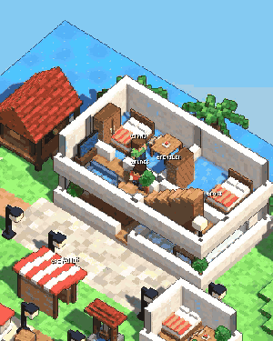</p>

**`pelabuhan`**: day, rooftop scene, exploded floors, night.

<p align="center">
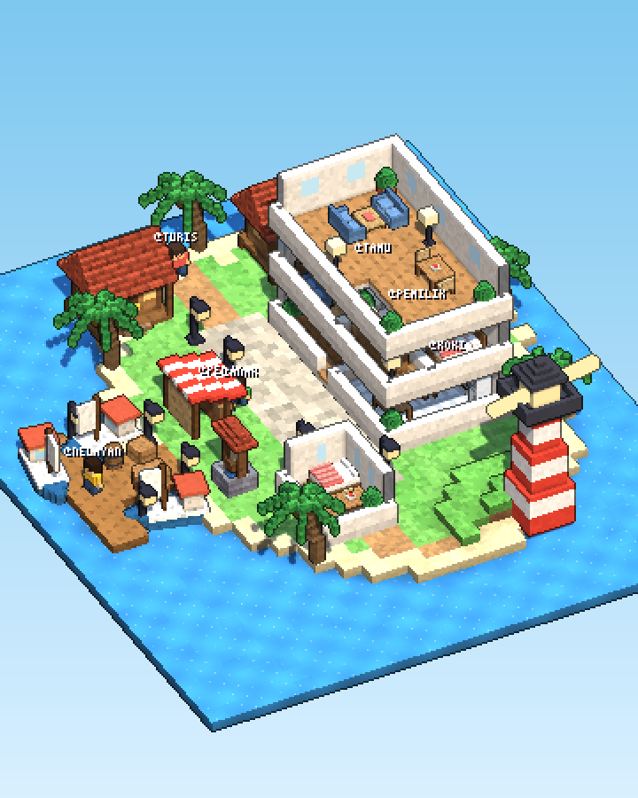
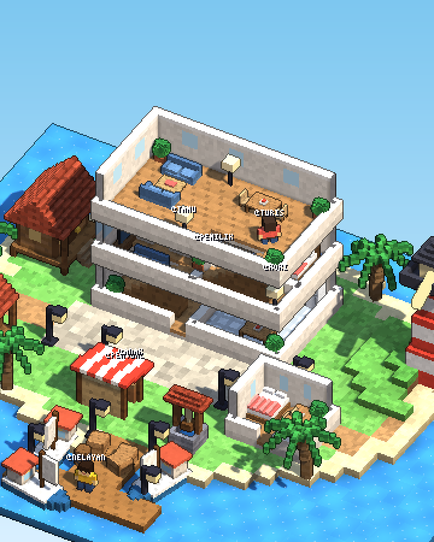
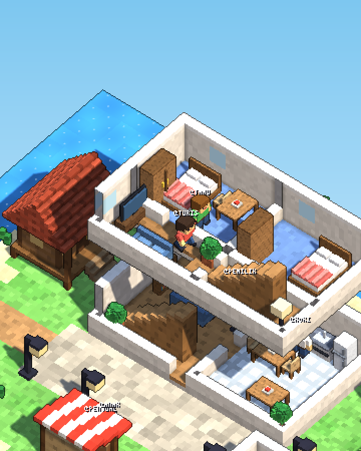
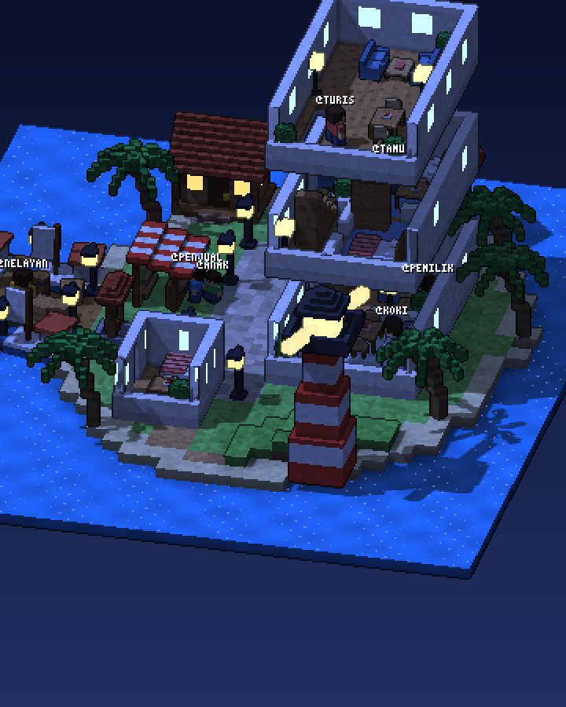
</p>

**`rumah`**: ground floor, upper floor, exploded.

<p align="center">
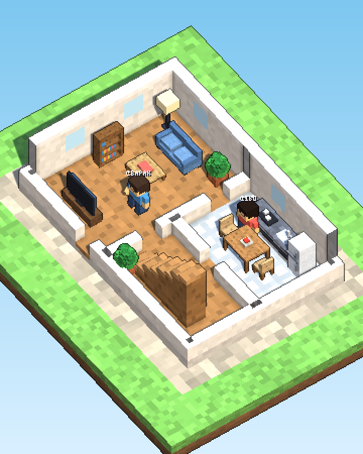
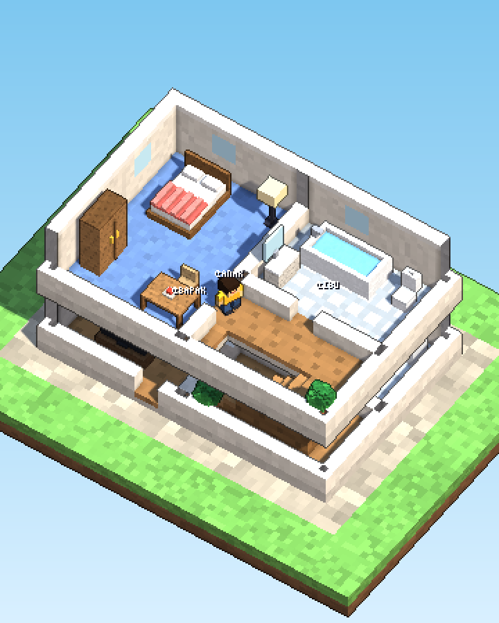
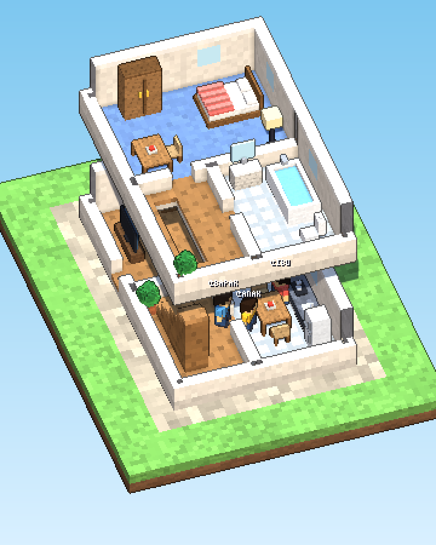
</p>

**`kampung`**: day and night. **`r3dlive`**: the Rune GPU UI.

<p align="center">
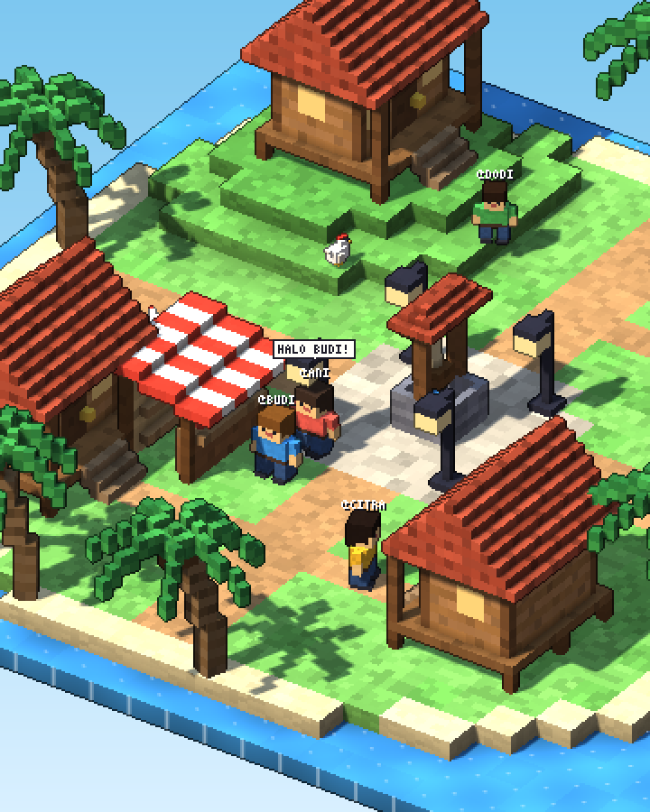
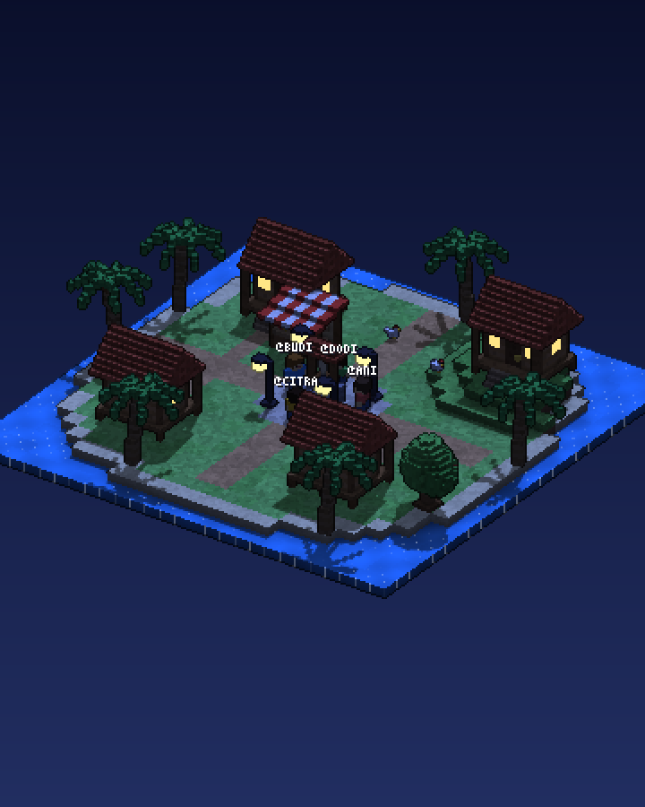
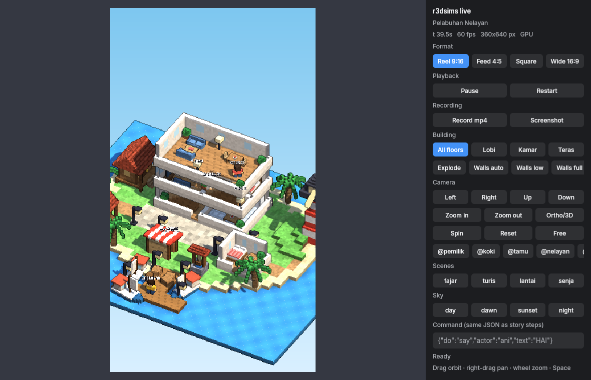
</p>

Regenerate them: `r3dsims template pelabuhan -o harbor && r3dsims render harbor/scene.json -o shot.png --preset feed --size 720x900 --pixel 2 --at 40`
(`rumah` stills at `--at 4 / 8.5 / 22`, `kampung` at `--at 14 / 39`).

## Install

**One prompt** (paste into Claude Code, Codex or any shell-capable agent): see
[`docs/INSTALL_PROMPT.md`](docs/INSTALL_PROMPT.md). It installs the binaries and the agent skills
and verifies them with a real render.

Or by hand:

```
curl -fsSL https://raw.githubusercontent.com/igun997/r3dsims/main/scripts/install.sh -o install.sh
sh install.sh          # Linux x86_64 or macOS arm64: binaries -> ~/.local/bin, skills -> ~/.claude/skills
```

Windows: take the `.zip` from the [Releases](https://github.com/igun997/r3dsims/releases) page.
From source: `cargo build --release --workspace` (Rust stable; Linux needs `libxkbcommon-dev
libwayland-dev libx11-dev libxcb1-dev libxcursor-dev libxi-dev libvulkan-dev pkg-config`).

Needs a GPU adapter (Vulkan, Metal or DX12; on a GPU-less Linux box install `mesa-vulkan-drivers`)
and `ffmpeg` for mp4 output.

## Use

```
r3dsims template pelabuhan -o harbor            # scene + 27 assets as editable JSON
r3dsims validate harbor/scene.json              # runs the whole story headless, reports problems
r3dsims render harbor/scene.json -o reel.mp4 --preset reel --seconds 58
r3dsims render harbor/scene.json -o shot.png --preset feed --at 40
r3dlive --demo pelabuhan                        # live window (Rune): orbit, floors, scenes, record
r3dlive --file harbor/scene.json
```

## Agent skills

`.claude/skills/` (mirrored in `.agents/skills/`): `r3dsims` (start here), `r3dsims-assets`,
`r3dsims-scenes`, `r3dsims-record`, `r3dsims-install`. They are packaged into every release and
installed by `scripts/install.sh`.

## Build and release

This repo's author builds on a remote machine with rcargo (local `.claude/settings.json` and
`rcargo.toml` are git-ignored); everyone else uses plain cargo.

```
cargo build --release --workspace     # r3dsims (CLI) and r3dlive (Rune GPU UI)
cargo test -p r3dsims                 # GPU tests need an adapter, lavapipe is fine
```

CI (`.github/workflows/ci.yml`) tests and smoke-renders on every push. Pushing a tag `vX.Y.Z` runs
`.github/workflows/release.yml`: Linux, macOS (Apple silicon) and Windows archives plus `SHA256SUMS`
are attached to a GitHub release.

## How it renders

`src/gpu.rs` + `src/shader.wgsl`: shadow map (sun, 2048², PCF) -> scene pass at the low "pixel"
resolution (flat shading, procedural materials, per-corner ambient occlusion, night glow, water
shimmer; colour + object id + depth) -> post pass (depth/object outlines, name tags and speech
bubbles). Consumers upscale with nearest-neighbour. In `r3dlive` Rune hands its own wgpu device to
the compositor, so the diorama is drawn straight into the UI with no readback; recording renders a
second frame at the output size only while REC is on.

## Parts

| path | what |
| --- | --- |
| `src/model.rs`, `src/vox.rs` | modular voxel assets, clips, materials, AO bake, MagicaVoxel import |
| `src/terrain.rs` | ASCII-map terrain with textured tops |
| `src/building.rs` | dollhouse buildings from ASCII plans (floors, stairs, doors, cut-away, explode) |
| `src/nav.rs` | multi-layer A* (terrain, floors, stairs, doors) |
| `src/story.rs`, `src/world.rs` | story steps, simulation, scene schema, sky |
| `src/camera.rs` | orbit camera, tweens, follow, spin, manual input |
| `src/mesh.rs`, `src/gpu.rs`, `src/shader.wgsl` | GPU renderer |
| `src/record.rs` | mp4/webm/gif/png/sequence recorder with Instagram presets |
| `src/templates.rs`, `src/house.rs`, `src/harbor.rs` | asset builder helpers and the three templates |
| `crates/live` | `r3dlive`, the Rune GPU UI |

Formats: [`docs/FORMAT.md`](docs/FORMAT.md). Research and decisions: [`docs/RESEARCH.md`](docs/RESEARCH.md).

## Recording presets

`reel`/`story`/`tiktok` 1080x1920, `feed` 1080x1350, `square` 1080x1080, `landscape` 1920x1080.
The renderer draws at 1/3 of that and upscales with nearest-neighbour. `--audio track.mp3` muxes
audio; `--commands cmds.json` adds timed camera/story/building events to a render without editing
the scene.

MIT licensed. The live app uses [Rune](https://github.com/anomalyco/rune) (MIT).
